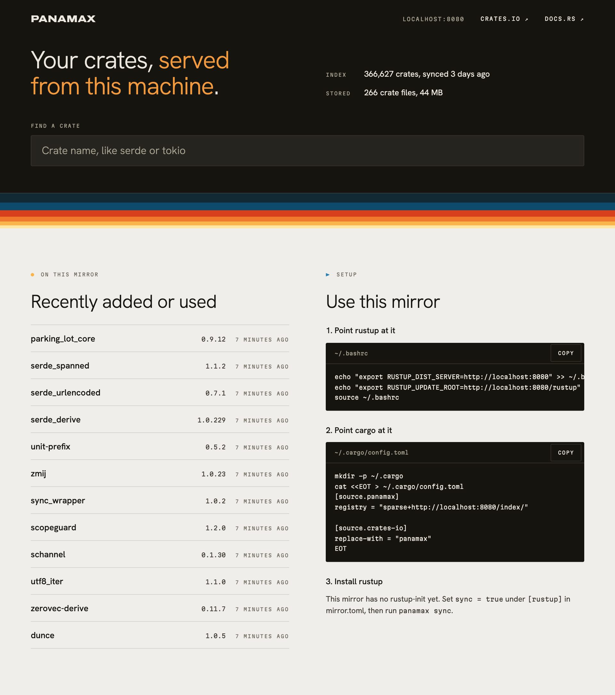

# Panamax

<p align="center"></p>

Panamax mirrors `rustup` toolchains and a slim copy of crates.io, so you can keep building Rust, and rebuild infrastructure, when the internet goes down.

- **rustup:** toolchains are synced ahead of time with `panamax sync`.
- **crates.io baseline:** `panamax sync` keeps every crate, but not every version. Per crate it keeps the newest version of each of the newest 3 semver lines, the newest that builds on each pinned toolchain, and everything those depend on. That's about 745k of 3.5M versions. Baseline versions are never deleted.
- **Everything else:** `panamax serve` fetches any other version the first time `cargo` asks for it while crates.io is reachable, and keeps it until it goes unused for 180 days.
- **Offline:** the index served to `cargo` only lists versions on disk, so `cargo` only ever resolves versions that will download.
- **Web page:** `panamax serve` also serves a [page](#web-page) to search the index, see which versions are stored, and copy the client setup.

This is a fork of [panamax-rs/panamax](https://github.com/panamax-rs/panamax), which is no longer actively maintained.

## Installation

This fork is not published on crates.io. Install it from git:

```
$ cargo install --locked --git https://github.com/mvdschee/panamax
```

Alternatively, you can clone this repository and `cargo build` or `cargo run` within it.

## Docker

Panamax is available as a docker image on GHCR, so you can run:

```
$ docker run --rm -it -v /path/to/mirror/:/mirror --user $(id -u) ghcr.io/mvdschee/panamax init /mirror
(Modify /path/to/mirror/mirror.toml as needed)
$ docker run --rm -it -v /path/to/mirror/:/mirror --user $(id -u) ghcr.io/mvdschee/panamax sync /mirror
(Once synced, serve the mirror)
$ docker run --rm -it -v /path/to/mirror/:/mirror --user $(id -u) -p8080:8080 ghcr.io/mvdschee/panamax serve /mirror
```

Alternatively, you can run panamax in a bare-metal environment like below.

### Init

In Panamax, mirrors consist of self-contained directories. To create a mirror directory `my-mirror`:

```
$ panamax init my-mirror
20:25:29.553 04-11-26 [INFO] Successfully created mirror base at `my-mirror`.
```

Use `--ignore-rustup` to leave out rustup and mirror only crates.

### Modify mirror.toml

Within the directory, you'll find a `mirror.toml` file with the rustup settings: which channels, platforms and pinned versions to keep. The `pinned_rust_versions` toolchains also decide which crate versions count as "builds on this toolchain" for the baseline. Under `[crates]`, `sync = false` turns off the baseline for a cache-only mirror.

### Sync

`panamax sync` downloads the rustup toolchains, then updates the crates baseline. The two run independently, so a rustup failure doesn't skip the crates:

```
$ panamax sync my-mirror
20:25:29.553 04-11-26 [INFO] Syncing Rustup repositories...
[1/5] Syncing rustup-init files... ██████████████████████████████████████████████████████████████ 27/27 [00:00:06]
[2/5] Syncing latest stable...     ████████████████████████████████████████████████████████████ 602/602 [00:09:02]
[3/5] Syncing latest beta...       ████████████████████████████████████████████████████████████ 524/524 [00:07:29]
[4/5] Syncing latest nightly...    ████████████████████████████████████████████████████████████ 546/546 [00:08:56]
[5/5] Cleaning old files...        ████████████████████████████████████████████████████████████ 546/546 [00:00:00]
21:01:04.118 04-11-26 [INFO] Syncing Rustup repositories complete!
21:01:04.119 04-11-26 [INFO] Sync complete.
```

The crates baseline uses a shallow checkout of the crates.io git index (`crates.io-index/`, about 400 MB of git data). Computing it takes about 1 GB of memory. It downloads kept versions that are missing, then deletes files that are outside the baseline and haven't been used for 180 days.

- `--dry-run` skips rustup and reports what the crates sync would download and delete. It changes nothing except the index checkout.
- If a run would delete more than 10% of all crate files, it stops before downloading or deleting anything. Pass `--allow-mass-delete` to go ahead.

Run it in a nightly cronjob.

## Server

```
$ panamax serve my-mirror
20:25:29.584 04-11-26 [INFO] Running on http://localhost:8080
```

This serves the rustup mirror, the crate cache and a web page.

Pass `--offline` to never contact crates.io and serve only what is cached, for example to test that your projects still build without internet.

The server speaks plain HTTP. For HTTPS, put it behind a reverse proxy. The download URL in `index/config.json` is built from the request's `Host` and `X-Forwarded-Proto` headers, so the proxy must pass both.

### Web page

<p align="center"></p>

Open the server's address in a browser. The home page shows the index and storage totals, the crates most recently added or used, and the commands to point `rustup` and `cargo` at this mirror, with its address already filled in.

Search finds crates by name. A crate page lists every version in the index, grouped by compatibility line and marked as stored here, not stored, or withdrawn by the author (yanked). Each version shows its release date, minimum Rust version, dependencies and features, plus a download button when it's stored.

The page loads nothing from the internet, so it works offline. Its CSS, JS and fonts are built into the binary, and the data comes from the index checkout and the crate files. Descriptions and READMEs live inside `.crate` files, so the page links to crates.io and docs.rs for those.

Search and crate pages read the index checkout, so they start working once `panamax sync` has updated the crates baseline. A cache-only mirror (`sync = false` under `[crates]`) has no checkout.

`panamax sync` writes the crate names and disk totals to files, and the page reads those, so opening it never walks the mirror. Totals and the recently used list are as fresh as the last sync; the page shows when they were counted. Each search hit and crate page still reads its own crate live.

## Configuring `rustup` and `cargo`

Once you have a mirror server set up and running, it's time to tell your Rust components to use it. The [web page](#web-page) has these same commands with the mirror's address filled in.

### Setting environment variables

`rustup` finds the mirror through two environment variables. Assuming the mirror is hosted at http://panamax.internal/:

```
export RUSTUP_DIST_SERVER=http://panamax.internal
export RUSTUP_UPDATE_ROOT=http://panamax.internal/rustup
```

`rustup` needs them every time it runs, so add them to your `.bashrc` (or equivalent).

### Installing `rustup`

Skip this step if `rustup` is already installed. Without access to https://rustup.rs, you can install it from the `rustup-init` files on the mirror.

Assuming the mirror is hosted at http://panamax.internal/, you will find the `rustup-init` files at http://panamax.internal/rustup/dist/. The `rustup-init` file you want depends on your architecture. Assuming you're running desktop Linux on a 64-bit machine:

```
wget http://panamax.internal/rustup/dist/x86_64-unknown-linux-gnu/rustup-init
chmod +x rustup-init
./rustup-init
```

The installer works the same as the one from https://rustup.rs, and `rustup` then keeps your Rust installation updated through the mirror.

### Configuring `cargo`

Point `cargo` at the mirror by adding these lines to `~/.cargo/config.toml` (create the file if it doesn't exist):

```
[source.panamax]
registry = "sparse+http://panamax.internal/index/"
[source.crates-io]
replace-with = "panamax"
```

`cargo` now fetches crates through the mirror.

### Testing configuration

To check that everything works:

```
$ cargo install ripgrep
```

This will install the grep-like `rg` tool (which is a great tool - props to burntsushi!). If `cargo` successfully downloads and builds everything, you have yourself a working mirror. Congratulations!

### Proxies

If panamax itself has to reach the internet through a proxy, set `HTTPS_PROXY` (and `HTTP_PROXY`) to something like `http://your.proxy:1234` before running `sync` or `serve`.

## Development

```
$ make check            # clippy, fmt and tests
$ make local            # serve a crate cache in .local/mirror on port 8282
$ make local OFFLINE=1  # the same, serving only what is cached
$ make local-check      # fetch the crates in Cargo.lock through it, with a fresh cargo home
$ make dev              # make local, restarting on code changes (needs watchexec)
$ make release          # tag the version in Cargo.toml and push it, which publishes the image
```

## License

Licensed under the terms of the MIT license and the Apache License (Version 2.0)

See [LICENSE-MIT](LICENSE-MIT) and [LICENSE-APACHE](LICENSE-APACHE) for details.

The fonts in `static/fonts` are under the SIL Open Font License, with each license file next to them.

### Contribution

Unless you explicitly state otherwise, any contribution intentionally submitted
for inclusion in the work by you, as defined in the Apache-2.0 license, shall be dual licensed as above, without any
additional terms or conditions.
